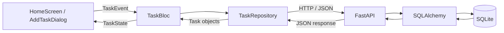

# Flutter Task Manager

A Mobile App Development midterm project with a Flutter mobile interface, BLoC state management, and a Python REST API. Tasks are stored in SQLite on the backend and loaded through HTTP requests.

## Implemented features

- Load tasks automatically on startup and reload them with the refresh button.
- Create a task through an Add/Cancel dialog; blank titles are ignored by the UI.
- Toggle completion with a checkbox and display completed titles with strikethrough.
- Delete tasks using the delete button.
- Display an empty-list message, a loading indicator, error SnackBars, and a Retry button when a request fails with an empty task list.
- Persist task creation, updates, and deletion in the backend database across server restarts.

The mobile interface supports changing completion status. The API also supports updating a title, but the current UI has no title-editing control. The app requires a running backend; it does not implement offline storage or synchronization.

## Technology stack

| Layer | Technology | Role |
| --- | --- | --- |
| Mobile UI | Flutter and Dart, Material 3 | Screens, dialogs, lists, and controls |
| State management | `flutter_bloc` `^9.1.1` | Events, asynchronous operations, and UI states |
| Value equality | `equatable` `^3.0.0` | Task, event, and state comparisons |
| HTTP client | `http` `^1.6.0` | JSON requests to the backend |
| API | Python, FastAPI, Uvicorn | Routes, server lifecycle, and development server |
| Validation | Pydantic | Request validation and response schemas |
| Persistence | SQLAlchemy and SQLite | ORM sessions and persistent task records |
| Tests | `flutter_test`, HTTP `MockClient`, pytest, HTTPX | Widget and backend API tests |

The Dart SDK constraint in `pubspec.yaml` is `^3.13.5` (at least 3.13.5 and below 4.0.0). Use a Flutter SDK that includes a compatible Dart version. Backend dependency ranges are declared in `backend/requirements.txt`; Python 3.10 or newer is required by the source syntax.

## Architecture



`main.dart` creates a `TaskRepository` with an HTTP client, provides it through `RepositoryProvider`, and creates `TaskBloc` through `BlocProvider`. It immediately dispatches `LoadTasks`. The HTTP client is closed when its provider is disposed.

The UI dispatches events instead of making network calls. `TaskBloc` emits a loading state, awaits a repository operation, then emits success or failure. `TaskRepository` builds requests, checks HTTP status codes, and converts JSON to `Task` objects. FastAPI validates input, uses a SQLAlchemy session to read or commit records, and serializes the result. `BlocConsumer` rebuilds the screen from state and displays errors through its listener.

For example, pressing Add dispatches `AddTask(title)`. The BLoC calls `repository.addTask(title)`, which sends `POST /tasks`. After the backend commits the task and returns HTTP 201, the BLoC appends the returned task to its list and emits success.

### Events and states

| Event | Repository operation | Effect on successful state |
| --- | --- | --- |
| `LoadTasks()` | `getTasks()` → GET | Replace the list with server records |
| `AddTask(title)` | `addTask(title)` → POST | Append the created task |
| `ToggleTask(id)` | `updateTask(task)` → PUT | Replace the task with the server response |
| `DeleteTask(id)` | `deleteTask(id)` → DELETE | Remove the task from the list |

`TaskState` contains `List<Task> tasks`, `TaskStatus status`, and nullable `String error`. Status values are `initial`, `loading`, `success`, and `failure`. Loading and failure emissions retain the current task list; failures include the caught exception as text. During loading the UI shows a spinner in place of the list.

## Project structure

```text
task_manager/
├── lib/
│   ├── main.dart                     # App setup, providers, and API base URL
│   ├── bloc/
│   │   ├── task_bloc.dart            # Asynchronous event handlers
│   │   ├── task_event.dart           # Load, add, toggle, and delete events
│   │   └── task_state.dart           # TaskState and TaskStatus
│   ├── models/task.dart              # Task model and JSON decoding
│   ├── repositories/task_repository.dart  # HTTP API client
│   └── screens/home_screen.dart      # Task list and add-task dialog
├── test/widget_test.dart            # Mocked HTTP widget test
├── backend/
│   ├── __init__.py
│   ├── main.py                      # App factory, lifecycle, CORS, endpoints
│   ├── database.py                  # SQLite path, base, engine, sessions
│   ├── models.py                    # SQLAlchemy Task table
│   ├── schemas.py                   # Pydantic schemas
│   ├── requirements.txt
│   ├── pytest.ini
│   ├── tests/test_api.py
│   └── README.md                    # Backend-specific documentation
├── android/                         # Android runner and build configuration
├── ios/                             # iOS runner and Xcode project
├── linux/, macos/, windows/, web/    # Additional Flutter platform scaffolding
├── pubspec.yaml                     # Dart SDK and package constraints
├── pubspec.lock                     # Resolved Dart package versions
├── analysis_options.yaml            # Dart lint configuration
└── README.md
```

`backend/tasks.db` is created at server startup. The virtual environment, database, and generated build/cache files are ignored by Git. Additional platform folders are present, but this README describes the mobile workflow; their presence does not establish tested desktop or web support.

## Setup and launch on macOS

Run all commands below from the project root.

### 1. Prepare the tools

Install a compatible Flutter SDK and Python 3.10+. For Android, install Android Studio, the Android SDK, and an emulator. For iOS, install Xcode with an iOS Simulator runtime and complete its initial setup.

```sh
flutter --version
python3 --version
flutter doctor
flutter pub get
```

Resolve the relevant Android/iOS issues reported by `flutter doctor` before running the app.

### 2. Start the backend

```sh
python3 -m venv backend/.venv
source backend/.venv/bin/activate
python -m pip install -r backend/requirements.txt
python -m uvicorn backend.main:app --reload --host 0.0.0.0 --port 8000
```

Keep this terminal running. Interactive API documentation is available at <http://127.0.0.1:8000/docs>. A quick connectivity check is:

```sh
curl http://127.0.0.1:8000/tasks
```

An empty database returns `[]`. SQLite tables are created automatically. The database path is resolved relative to `backend/database.py`, so data stays in `backend/tasks.db` regardless of the server's working directory. Restarting the server preserves tasks; deleting that file removes the saved data.

### 3. Run on Android Emulator

Start an Android emulator from Android Studio, then use a second terminal:

```sh
flutter devices
flutter run -d <android-device-id>
```

Replace `<android-device-id>` with an ID listed by `flutter devices`. `main.dart` selects `http://10.0.2.2:8000` on Android, which addresses the development host from the standard Android Emulator.

The debug manifest contains the INTERNET permission. The main manifest does not declare INTERNET or an explicit cleartext HTTP allowance. If an Android configuration rejects local HTTP traffic, its network policy must be configured separately; a release build is not documented here as verified.

### 4. Run on iOS Simulator

Start a simulator on macOS:

```sh
open -a Simulator
flutter devices
flutter run -d <ios-simulator-device-id>
```

The non-Android branch in `main.dart` uses `http://127.0.0.1:8000`. The existing iOS `Info.plist` allows arbitrary loads for local HTTP development. The backend must run on the same Mac for this simulator setup.

The base URL is currently selected directly in `main.dart`; there is no environment-variable or `--dart-define` override. Physical phones require the Mac's LAN address and suitable platform network settings; the existing emulator/simulator URLs are not a physical-device configuration.

## HTTP API

### Task format

```json
{
  "id": 1,
  "title": "Study Flutter",
  "isCompleted": false
}
```

These are the exact response keys. IDs are integers generated by the database, titles are strings, and completion values are JSON booleans.

| Method | Endpoint | Request body | Successful response |
| --- | --- | --- | --- |
| GET | `/tasks` | None | 200, JSON array ordered by ID |
| POST | `/tasks` | `{"title":"Study Flutter"}` | 201, created task; completion defaults to false |
| PUT | `/tasks/{id}` | `{"title":"Revised title"}` and/or `{"isCompleted":true}` | 200, updated task |
| DELETE | `/tasks/{id}` | None | 204, empty body |

PUT supports partial updates: omitted fields are unchanged, and `{}` is a valid no-op for an existing task. The Flutter repository currently sends only the inverted `isCompleted` value on PUT. It does not JSON-decode DELETE responses.

Pydantic trims titles and rejects empty/whitespace-only titles, explicit nulls, incorrect types, and unknown properties. `isCompleted` must be a boolean. Invalid bodies or noninteger path IDs return 422. Updating or deleting an unknown integer ID returns 404 with `{"detail":"Task not found"}`.

Example requests (replace `1` with the created task's ID):

```sh
curl -i -X POST http://127.0.0.1:8000/tasks \
  -H 'Content-Type: application/json' \
  -d '{"title":"Study Flutter"}'

curl http://127.0.0.1:8000/tasks

curl -X PUT http://127.0.0.1:8000/tasks/1 \
  -H 'Content-Type: application/json' \
  -d '{"isCompleted":true}'

curl -i -X DELETE http://127.0.0.1:8000/tasks/1
```

CORS allows all origins for local development, with GET, POST, PUT, and DELETE methods and arbitrary headers. Credentials are disabled. CORS does not replace native platform network configuration. Authentication is not implemented.

## Testing

### Flutter

```sh
flutter pub get
flutter analyze
flutter test test/widget_test.dart
```

The widget test supplies a real `TaskBloc` and `TaskRepository` with an HTTP `MockClient`. It mocks initial loading and creation, checks that adding shows the task and closes the dialog, and checks that Cancel closes the dialog without adding a task. It runs independently of the backend. It does not cover mobile networking or the complete CRUD flow.

The last attempted Flutter analysis in this workspace reported no issues. The last widget-test attempt could not start because the local Flutter SDK was missing the `darwin-x64/flutter_tester` executable; no passing widget-test result is claimed. A complete Flutter SDK installation with the required engine artifacts is needed to run it.

### Backend

With the backend virtual environment activated:

```sh
python -m pytest -c backend/pytest.ini -q
```

Backend tests cover CRUD, partial and empty updates, response fields, invalid requests, missing IDs, CORS, and persistence across separately created application instances. Temporary SQLite databases isolate tests from saved application data. The earlier backend test run in this workspace completed with **20 passed** and one dependency deprecation warning. Tests were not rerun for this documentation-only change.

For a manual integration check, keep the backend running, add a task in the app, toggle completion, refresh, restart the server, and refresh again. Delete the task and refresh to verify removal. This is a suggested verification procedure, not a claim that those device checks have been performed.

## Midterm implementation overview

The project demonstrates four core areas of mobile application development:

| Implementation area | Evidence in this project |
| --- | --- |
| 1. Flutter mobile interface | Material task list, add dialog, completion checkbox, delete and refresh actions in `home_screen.dart` |
| 2. BLoC state management | Four events and explicit initial/loading/success/failure states in `lib/bloc/` |
| 3. HTTP API integration | `TaskRepository` calls FastAPI through JSON GET, POST, PUT, and DELETE requests |
| 4. Persistent data storage | SQLAlchemy commits tasks to SQLite; backend tests exercise persistence across application restarts |
